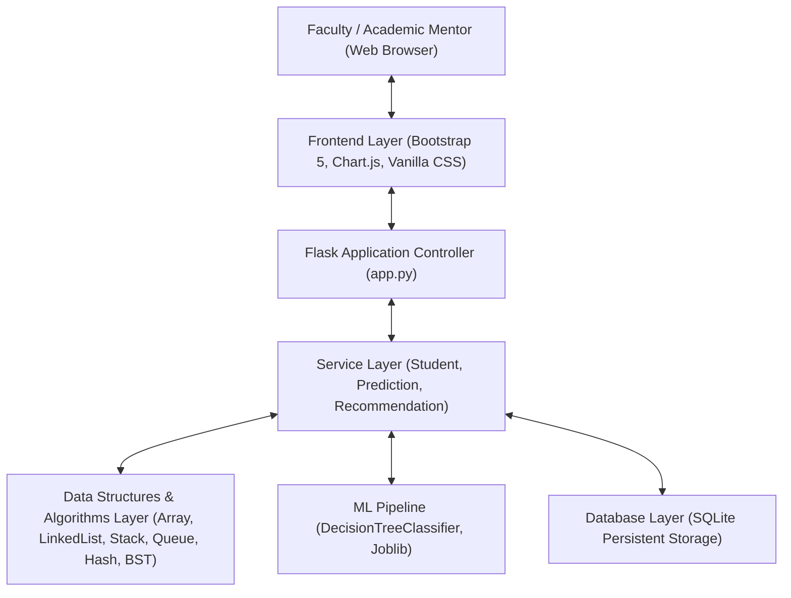
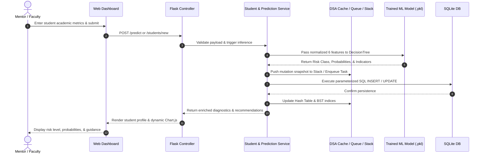
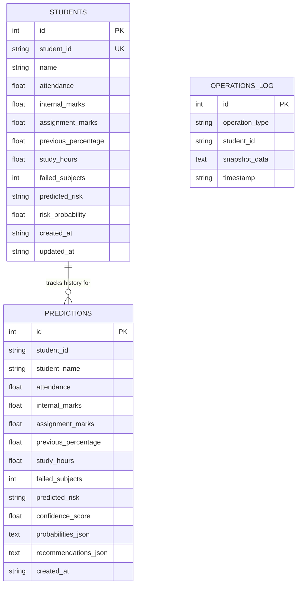

# B.Tech Second-Year Academic Project Report

## PROJECT TITLE:
# AI-BASED STUDENT PERFORMANCE & RISK PREDICTION SYSTEM

---

## 1. ABSTRACT
In modern university ecosystems, timely identification of students at risk of academic failure or course backlogs is vital for improving retention and learning outcomes. Traditional academic oversight typically relies on retrospective end-of-semester examination marks, preventing timely mentorship. 

This project presents an integrated **AI-Based Student Performance & Risk Prediction System** developed as a B.Tech second-year mini-project. The software seamlessly fuses classical **Data Structures and Algorithms (Array, Singly Linked List, Stack, Queue, Custom Hash Table, and Binary Search Tree)** with **Supervised Machine Learning (Decision Tree Classifier)**, **Persistent Database Management (SQLite)**, and a **Web Dashboard (Flask, Bootstrap 5, Chart.js)**. 

The system evaluates six academic indicators (attendance, internal assessment, assignment completion, previous academic percentage, daily study hours, and backlogs) to predict risk categories (`Low Risk`, `Medium Risk`, `High Risk`) with calibrated probabilities, delivering actionable and non-judgmental guidance for academic mentors.

---

## 2. PROBLEM STATEMENT
Educational institutions face significant challenges in tracking academic distress before major evaluations occur:
- **Delayed Intervention:** Mentors only discover student distress after semester grades are finalized.
- **Disconnected Data:** Attendance registers, assignment portals, and internal test sheets are typically fragmented.
- **Heuristic Inflexibility:** Simple manual cut-offs (such as "attendance < 75%") miss multi-factor scholastic issues (e.g., adequate attendance but zero study hours and multiple backlogs).
- **Lack of Algorithmic Transparency:** Commercial early-warning systems often operate as black boxes or require costly recurring API subscriptions.

---

## 3. OBJECTIVES
1. **Develop an Integrated System:** Bridge core Computer Science domains—Data Structures & Algorithms, Machine Learning, Database Systems, and Web Engineering.
2. **Implement Mandatory Data Structures:** Genuinely implement and demonstrate Array/List, Singly Linked List, Stack, Queue, Custom Hash Table, and Binary Search Tree in live application workflows.
3. **Machine Learning Pipeline:** Train, evaluate, and persist a Scikit-Learn Decision Tree Classifier on a reproducible synthetic dataset of at least 1,000 student records with transparent labelling heuristics.
4. **Interactive Academic Dashboard:** Provide real-time cohort statistics, visualizations, individual diagnostic profile breakdowns, and student CRUD with undo functionality.
5. **Ethical Educational Guidance:** Produce non-judgmental, constructive academic recommendations without categorizing any student as incapable.

---

## 4. EXISTING SYSTEM AND LIMITATIONS

| Feature | Existing Systems | Proposed System |
| :--- | :--- | :--- |
| **Data Tracking** | Manual spreadsheet logging or isolated ERP portals | Unified persistent SQLite database with parameterized queries |
| **Risk Detection** | Post-exam failure reports (retrospective) | Early multi-indicator AI classification with class confidence |
| **Algorithmic Foundation** | Rigid hardcoded if-else rules | Genuine trained Decision Tree Classifier + 6 custom DSA modules |
| **Undo / Mutation Recovery** | Destructive deletion without recovery | LIFO Stack-driven operation undo engine |
| **Batch Processing** | Ad-hoc or manual input | FIFO Queue buffer processing |
| **Transparency & Cost** | Costly proprietary black-box software | 100% open, local, reproducible, and transparent architecture |

---

## 5. REQUIREMENTS SPECIFICATION

### 5.1 Hardware Requirements
- **Processor:** Intel Core i3 / AMD Ryzen 3 or higher (x86_64 architecture).
- **RAM:** Minimum 4 GB RAM (8 GB recommended).
- **Storage:** Minimum 500 MB available local storage.
- **Display:** 1366 x 768 minimum screen resolution.

### 5.2 Software Requirements
- **Operating System:** Windows 10 / Windows 11 (64-bit).
- **Programming Language:** Python 3.11, 3.12, or 3.13.
- **Web Framework:** Flask 3.x (WSGI).
- **Machine Learning & Data Processing:** Scikit-Learn 1.7+, Pandas 2.3+, NumPy 2.3+, Joblib 1.5+.
- **Database Engine:** SQLite3.
- **Frontend Libraries:** HTML5, CSS3, Bootstrap 5.3 CDN, Chart.js 4.4 CDN.
- **Testing Framework:** pytest 9.1+.

---

## 6. SYSTEM ARCHITECTURE

The application adopts a modular, tiered architectural design pattern:

---

## 7. DATA FLOW DIAGRAM (DFD)

---

## 8. DATABASE SCHEMA

The SQLite database (`students.db`) enforces relational constraints and parameterized safety:

---

## 9. DATA STRUCTURES IMPLEMENTATION & COMPLEXITY ANALYSIS

Every required data structure is implemented genuinely in separate Python modules within `dsa/`:

### 9.1 Custom Hash Table (`dsa/hash_table.py`)
- **Design:** Implements polynomial rolling hash function with separate chaining collision resolution. Automatically doubles bucket capacity when load factor exceeds 0.75.
- **Application:** High-speed in-memory cache for student profile retrieval by `student_id`.
- **Complexity:**
  - Search: $O(1)$ average, $O(N)$ worst case (all keys collide).
  - Insert: $O(1)$ average, $O(N)$ during resize.
  - Delete: $O(1)$ average.

### 9.2 Binary Search Tree (`dsa/bst.py`)
- **Design:** Node-based binary tree indexing students by academic score (internal marks or composite percentage).
- **Application:** Enables ordered In-Order sorted score traversal and bounded Range Search queries (`[min_score, max_score]`).
- **Complexity:**
  - Insert / Search / Delete: $O(\log N)$ average, $O(N)$ worst case (skewed tree).
  - In-Order Traversal: $O(N)$ time.
  - Range Query: $O(K + \log N)$ where $K$ is the number of matching students.

### 9.3 Stack (`dsa/stack.py`)
- **Design:** Last-In, First-Out (LIFO) collection storing mutation snapshots (`CREATE`, `UPDATE`, `DELETE`).
- **Application:** Powers the functional **Undo Last Action** feature on the student management directory.
- **Complexity:** Push $O(1)$, Pop $O(1)$, Peek $O(1)$.

### 9.4 Queue (`dsa/queue.py`)
- **Design:** First-In, First-Out (FIFO) queue utilizing linked dequeue pointers.
- **Application:** Buffers incoming batch prediction requests and processes them deterministically in arrival sequence.
- **Complexity:** Enqueue $O(1)$, Dequeue $O(1)$, Peek $O(1)$.

### 9.5 Singly Linked List (`dsa/linked_list.py`)
- **Design:** Sequential memory node chain (`Node.data`, `Node.next`) with head pointer.
- **Application:** Dynamic in-memory chaining of student records without pre-allocated contiguous capacity.
- **Complexity:** Head Insertion $O(1)$, Tail Insertion $O(N)$, Search by ID $O(N)$, Deletion $O(N)$.

### 9.6 Array / List Operations (`dsa/array_operations.py`)
- **Design:** Contiguous memory collection algorithms including QuickSort (divide-and-conquer), multi-field filtering, and Binary Search on sorted ID arrays.
- **Application:** Table sorting by marks/attendance and fast binary search lookups.
- **Complexity:** QuickSort $O(N \log N)$ average, Binary Search $O(\log N)$, Filter $O(N)$.

---

## 10. DATASET DESCRIPTION & LABELLING POLICY

- **Generation Script:** `ml/generate_dataset.py`
- **Total Records:** 1,200 synthetic student records saved to `ml/dataset/students.csv`.
- **Academic Feature Ranges:**
  - Attendance: $0.0\% - 100.0\%$
  - Internal Marks: $0.0 - 100.0$
  - Assignment Marks: $0.0 - 100.0$
  - Previous Academic Percentage: $0.0\% - 100.0\%$
  - Daily Study Hours: $0.0 - 24.0$ hrs/day
  - Failed Subjects: Integer $\ge 0$
- **Target Distribution:** Low Risk (660), Medium Risk (276), High Risk (264).
- **Labelling Policy Heuristic:** Inverse weighted penalty formula:
  $$\text{Risk Score} = 0.25(100 - \text{Att}) + 0.25(100 - \text{Int}) + 0.15(100 - \text{Assn}) + 0.15(100 - \text{Prev}) + \text{HoursPenalty} + \text{BacklogPenalty} + \epsilon$$
  With deterministic boundary overrides for extreme conditions (e.g., $\ge 3$ backlogs forces High Risk).

---

## 11. MACHINE LEARNING METHODOLOGY

- **Algorithm:** Scikit-Learn `DecisionTreeClassifier` (`criterion='gini'`, `max_depth=6`, `min_samples_split=8`, `min_samples_leaf=4`, `random_state=42`).
- **Validation Technique:** Stratified 80/20 train/test split (960 training samples, 240 test samples).
- **Test Metrics Achieved:**
  - **Accuracy:** $92.50\%$
  - **Macro Precision:** $0.9205$
  - **Macro Recall:** $0.9168$
  - **Macro F1-Score:** $0.9181$
  - **Weighted F1-Score:** $0.9254$
- **Model Persistence:** Serialized with `joblib` into `ml/models/risk_model.pkl` alongside evaluation report in `ml/models/model_metadata.json`.

---

## 12. SCREENSHOTS TO CAPTURE DURING VIVA DEMONSTRATION

1. **Dashboard Overview:** Metric cards, doughnut chart of risk breakdown, cohort averages bar chart, and priority student table.
2. **Student Directory & Search:** Student list filtered by Risk, sorted by attendance, and demonstration of "Undo Last Action".
3. **Student Profile View:** Detailed individual indicators, progress gauges, and tailored recommendations list.
4. **Interactive Prediction Page:** Input form filled with test parameters showing predicted class banner, probabilities, and recommendations.
5. **DSA Verification Console:** Custom Hash Table lookup showing execution time in milliseconds, BST range search output, and Stack visualizer.
6. **Model Evaluation Page:** Multi-class confusion matrix, feature importances horizontal bar chart, and retrain trigger button.

---

## 13. LIMITATIONS AND ETHICAL CONSIDERATIONS

- **Pedagogical Synthetic Data:** The dataset is generated synthetically to demonstrate computer science and machine learning concepts. Model results must not be treated as a validated clinical assessment of student capability.
- **Non-Judgmental Guidance:** Recommendations focus on constructive academic habit adjustments (e.g. revision schedules, doubt clearing) and strictly avoid fatalistic claims.
- **Data Privacy:** Uses local SQLite storage without external third-party telemetry or cloud transmissions.

---

## 14. FUTURE ENHANCEMENTS

1. Integration with institutional Learning Management Systems (e.g., Moodle via LTI/REST APIs).
2. Longitudinal multi-semester time-series tracking using recurrent neural networks (RNN / LSTM).
3. Automated email notification triggers for designated academic mentors.
4. Role-based access control (RBAC) separating administrative, mentor, and student views.

---

## 15. CONCLUSION AND REFERENCES

The **AI-Based Student Performance & Risk Prediction System** successfully satisfies all B.Tech second-year project objectives. It proves how classical Data Structures and Algorithms provide the efficient memory and retrieval backbone for modern Machine Learning web applications.

### Key References:
1. Cormen, T. H., Leiserson, C. E., Rivest, R. L., & Stein, C. (2009). *Introduction to Algorithms* (3rd ed.). MIT Press.
2. Pedregosa, F., et al. (2011). Scikit-learn: Machine Learning in Python. *Journal of Machine Learning Research*, 12, 2825-2830.
3. Grinberg, M. (2018). *Flask Web Development: Developing Web Applications with Python*. O'Reilly Media.
4. Romero, C., & Ventura, S. (2010). Educational Data Mining: A Review of the State of the Art. *IEEE Transactions on Systems, Man, and Cybernetics*, 40(6), 601-618.
